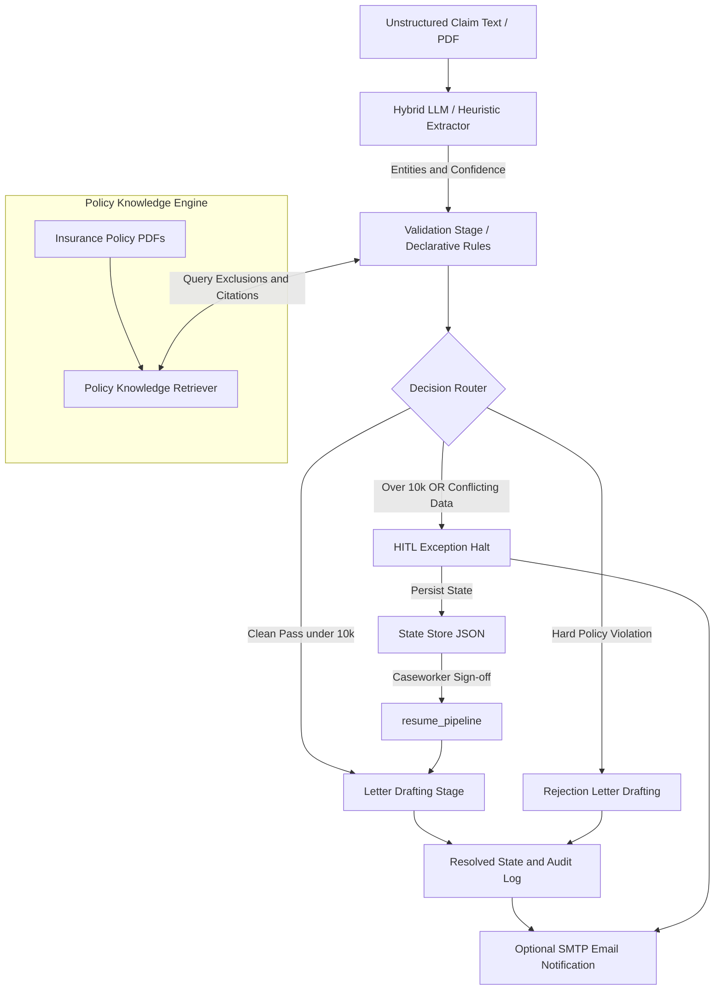

# Agentic Insurance Claims Engine

[](https://www.python.org/)
[](https://fastapi.tiangolo.com/)
[](https://react.dev/)
[](./LICENSE)

Portfolio project: an autonomous workflow agent for healthcare / insurance claim document processing. It runs a deterministic multi-step state machine with a declarative business rules engine, Human-in-the-Loop (HITL) exception handling, live SSE pipeline visualization, and optional SMTP email of decision letters.

---

## What this project demonstrates

- Multi-step agent orchestration (ingest → extract → validate → route → letter / HITL)
- RAG-backed policy checks against handbook text in `knowledge_base/policies/`
- HITL halt + resume with audit trail and caseworker sign-off
- React dashboard with live Server-Sent Events (SSE) DAG streaming
- Clickable **Claims Processed** / **HITL Exception Queue** drawer
- Optional SMTP notifications + Cursor MCP email tools on every outcome (approve / reject / HITL)

### Extensions added in this portfolio build

- Claims queue drawer (header metrics → filterable claim list → load claim into UI)
- SMTP decision-letter / HITL email notifications wired into the pipeline
- Local `claims-email` MCP server for Cursor (`mcp_email_server.py`)

---

## Optional upstream demo video

A short walkthrough of the original claims-automation concept (upstream demo, for context):

[Loom video walkthrough](https://www.loom.com/share/501465a4829742c4a8d275ad03dafb51)

---

## Key features

- **RAG Policy Knowledge Engine**: [`src/rag/retriever.py`](src/rag/retriever.py) queries insurance handbooks for coverage / exclusion citations
- **Multi-step orchestration**: Ingestion → Extraction → Rules → Router → HITL or Letter → Resolve
- **HITL trigger**: Claims over **$10,000** or with conflicting data halt and persist state for caseworker review
- **Resumable state machine**: `state/<claim_id>.json` with full audit log
- **Declarative rules**: [`src/validation/rules.py`](src/validation/rules.py) (`reject` / `escalate` / `warn`)
- **Hybrid extraction**: LLM when an API key is set; offline heuristic parser otherwise
- **Enterprise UX**: React dashboard + CLI (`cli.py`)

---

## System architecture



---

## Quick start

### 1. Install

```bash
git clone https://github.com/02surajpatil02-afk/agentic-insurance-claims-engine-main.git
cd agentic-insurance-claims-engine-main

python -m venv .venv
# Windows:
.venv\Scripts\activate
# macOS / Linux:
# source .venv/bin/activate

pip install -r requirements.txt
```

> A production frontend build is already under `frontend/dist`. Rebuild only if you change React sources: `cd frontend && npm install && npm run build`.

### 2. Optional: extraction API key

Works fully offline without keys. For LLM extraction:

```bash
# Windows PowerShell
$env:OPENAI_API_KEY="your-api-key"
# or
$env:GEMINI_API_KEY="your-api-key"
```

### 3. Optional: email decision letters (SMTP + MCP)

When SMTP is configured, every claim outcome (**approved**, **rejected**, or **HITL halt**) emails a notification to `EMAIL_NOTIFY_TO`.

1. Copy `.env.example` → `.env`
2. Create a [Gmail App Password](https://myaccount.google.com/apppasswords) (2-Step Verification required)
3. Set `SMTP_USER`, `SMTP_PASSWORD`, and `EMAIL_NOTIFY_TO` in `.env`
4. Restart the server

**Cursor MCP** (optional manual resend tools): [`.cursor/mcp.json`](.cursor/mcp.json)

| Tool | Purpose |
|------|---------|
| `send_email` | Send plain-text email |
| `send_claim_decision_letter` | Email letter / HITL summary for a `claim_id` |
| `email_status` | Check whether SMTP is configured |

If SMTP is not configured, the pipeline still runs; the audit trail records that email was skipped.

### 4. Run the dashboard

```bash
python run_server.py
```

- Web UI: http://localhost:8000  
- OpenAPI docs: http://localhost:8000/docs  

---

## CLI samples

```bash
# Clean auto-approve (~$3,450)
python cli.py --sample sample_claims/clean_approve.txt

# High-value HITL (> $10,000)
python cli.py --sample sample_claims/over_threshold.txt

# Resume halted claim
python cli.py --resume CLM-XXXXXXXX --action approve --notes "Authorized following senior clinical audit"

# Conflicting data / math mismatch
python cli.py --sample sample_claims/conflicting_data.txt

# Hard rejection (invalid policy)
python cli.py --sample sample_claims/clean_reject.txt

# List persisted claims
python cli.py --list
```

Windows helper: `.\run_custom_claim.ps1`

---

## Tests

```bash
python -m pytest tests/ -v
```

**28** tests covering API, extraction, rules, pipeline, and RAG.

---

## Business rules

| Rule ID | Name | Severity | Rationale |
|---------|------|----------|-----------|
| **R101** | Policy Format & Active Status | `REJECT` | Active policy format `POL-XXXXXXX` |
| **R102** | Valid Claim Amount | `REJECT` | Amount present and &gt; $0 |
| **R103** | Claimant Name Required | `REJECT` | Required for formal letters |
| **R104** | Excluded Category Check | `REJECT` | Non-covered / experimental keywords |
| **R105** | High-Value Threshold | `ESCALATE` | Amount &gt; $10,000 → HITL |
| **R106** | Data Integrity & Conflicts | `ESCALATE` | Warnings / low confidence / conflicts |
| **R107** | Line Item Math | `ESCALATE` | Itemized sum ≠ claimed total |

---

## Project layout

```
├── cli.py / run_server.py / server.py
├── mcp_email_server.py          # Cursor MCP email tools
├── sample_claims/               # Demo claim documents
├── knowledge_base/policies/     # Handbook text for RAG
├── src/
│   ├── pipeline.py              # State machine orchestrator
│   ├── extraction/ validation/ decision/ letters/ rag/
│   └── notifications/email.py   # SMTP notifications
├── frontend/                    # React dashboard (Vite)
├── tests/
└── state/                       # Runtime claim JSON (gitignored)
```

---

## License

MIT — see [LICENSE](./LICENSE).
